# Guía de PlantUML para diagramas Entidad/Relación

## Índice

1. [¿Qué es PlantUML?](#1-qué-es-plantuml)
2. [Instalación y herramientas](#2-instalación-y-herramientas)
3. [Estructura básica de un diagrama](#3-estructura-básica-de-un-diagrama)
4. [Entidades (tablas)](#4-entidades-tablas)
5. [Clases](#5-clases)
6. [Enumerados (enums)](#6-enumerados-enums)
7. [Relaciones y cardinalidad (notación pata de gallo)](#7-relaciones-y-cardinalidad-notación-pata-de-gallo)
8. [Relaciones de diagrama de clases](#8-relaciones-de-diagrama-de-clases)
9. [Casos típicos de modelado](#9-casos-típicos-de-modelado)
10. [Notación de Chen](#10-notación-de-chen)
11. [Organización: paquetes, notas y dirección](#11-organización-paquetes-notas-y-dirección)
12. [Estilos y apariencia](#12-estilos-y-apariencia)
13. [Macros y preprocesador](#13-macros-y-preprocesador)
14. [Ejemplo completo: tienda online](#14-ejemplo-completo-tienda-online)
15. [Buenas prácticas](#15-buenas-prácticas)
16. [Errores frecuentes](#16-errores-frecuentes)
17. [Chuleta rápida](#17-chuleta-rápida)

---

## 1. ¿Qué es PlantUML?

**PlantUML** es una herramienta de código abierto que genera diagramas a partir de una descripción en texto plano. En lugar de arrastrar cajas con el ratón, se escribe el diagrama como si fuera código.

Ventajas principales:

- **Control de versiones**: los diagramas son ficheros de texto (`.puml`, `.plantuml`, `.pu`), por lo que se pueden guardar en Git, comparar con `diff` y revisar en *pull requests*.
- **Mantenimiento sencillo**: cambiar el nombre de un campo es editar una línea, no recolocar una caja.
- **Diseño automático**: PlantUML coloca los elementos por sí mismo (usa Graphviz o su motor interno).
- **Integración**: funciona en VS Code, IntelliJ, Confluence, GitLab, wikis, generadores de documentación, etc.
- **Varios tipos de diagrama**: clases, secuencia, casos de uso, actividad, estados, componentes, Gantt, mapas mentales y, lo que nos ocupa, **Entidad/Relación**.

Para diagramas E/R, PlantUML ofrece dos enfoques:

| Enfoque | Bloque | Uso típico |
|---|---|---|
| Notación de Ingeniería de la Información (pata de gallo) | `@startuml` ... `@enduml` | Modelo lógico/físico de bases de datos relacionales |
| Notación de Chen | `@startchen` ... `@endchen` | Modelo conceptual académico (entidades, atributos y rombos de relación) |

---

## 2. Instalación y herramientas

### Opción 1: sin instalar nada

- **Servidor web oficial**: `https://www.plantuml.com/plantuml` — se pega el código y se obtiene la imagen.
- **Kroki** (`https://kroki.io`): servicio que renderiza PlantUML y otros formatos de diagramas.

> Atención: si el modelo contiene información confidencial, no lo pegues en servidores públicos. Usa una instalación local o un servidor propio.

### Opción 2: línea de comandos

Requisitos: **Java** (JRE 8 o superior). Graphviz es recomendable, aunque las versiones recientes incluyen un motor interno.

```bash
# Generar PNG (por defecto)
java -jar plantuml.jar modelo.puml

# Generar SVG (ideal para documentación, escala sin perder calidad)
java -jar plantuml.jar -tsvg modelo.puml

# Generar PDF (requiere dependencias adicionales)
java -jar plantuml.jar -tpdf modelo.puml

# Procesar todos los ficheros de una carpeta
java -jar plantuml.jar -tsvg "docs/diagramas/**.puml"

# Comprobar la instalación y si encuentra Graphviz
java -jar plantuml.jar -testdot
```

Con Docker:

```bash
docker run --rm -v "$(pwd)":/data plantuml/plantuml -tsvg /data/modelo.puml
```

### Opción 3: editores

| Editor | Extensión / complemento | Vista previa |
|---|---|---|
| VS Code | *PlantUML* (jebbs) | `Alt + D` |
| IntelliJ / PyCharm | *PlantUML Integration* | Panel lateral |
| Eclipse | *PlantUML Eclipse Plugin* | Vista dedicada |
| Obsidian | *PlantUML* | En la propia nota |

### Sin Graphviz

Si no tienes Graphviz instalado, puedes forzar el motor interno (Smetana) añadiendo esta línea al principio del diagrama:

```plantuml
!pragma layout smetana
```

---

## 3. Estructura básica de un diagrama

Todo diagrama empieza y termina con unas etiquetas delimitadoras:

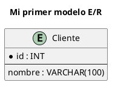

Elementos clave:

- `@startuml` / `@enduml`: delimitan el diagrama. El nombre tras `@startuml` es opcional y se usa como nombre del fichero generado.
- `'` comentario de una línea; `/' ... '/` comentario de bloque.
- `title`, `header`, `footer`, `caption` y `legend` añaden información al diagrama.

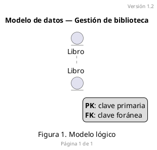

---

## 4. Entidades (tablas)

La palabra reservada `entity` representa una tabla o entidad. Es la forma más habitual de hacer diagramas E/R en PlantUML.

### 4.1. Entidad sencilla

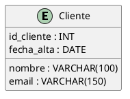

### 4.2. Nombre visible y alias

Cuando el nombre tiene espacios, tildes o se quiere un identificador corto para las relaciones, se usa `as`:

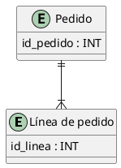

### 4.3. Separadores: clave primaria frente al resto

Por convención, la clave primaria se coloca arriba, separada del resto de atributos con `--`:

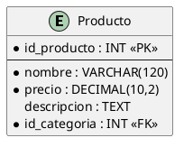

Convenciones habituales:

- `*` delante del atributo: campo **obligatorio** (`NOT NULL`). PlantUML lo dibuja con un indicador.
- `<<PK>>`, `<<FK>>`, `<<UK>>`, `<<generated>>`: estereotipos para indicar claves y otras características.

Tipos de separador disponibles:

| Separador | Aspecto |
|---|---|
| `--` | Línea continua |
| `..` | Línea punteada |
| `==` | Línea doble |
| `__` | Línea gruesa |
| `-- Texto --` | Línea con título |

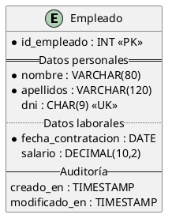

### 4.4. Formato del texto (Creole)

Dentro de entidades, notas y etiquetas se puede usar el lenguaje de marcado **Creole**:

| Sintaxis | Resultado |
|---|---|
| `**texto**` | Negrita |
| `//texto//` | Cursiva |
| `__texto__` | Subrayado |
| `""texto""` | Monoespaciado |
| `--texto--` | Tachado |
| `<color:red>texto</color>` | Color |
| `<&key>` | Icono OpenIconic (llave) |

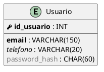

### 4.5. Icono personalizado de la entidad

Por defecto aparece un círculo con la letra **E**. Se puede cambiar por otra letra y color:

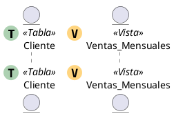

Para ocultarlo por completo (muy habitual en E/R):

```plantuml
hide circle
```

---

## 5. Clases

Aunque `entity` es lo más cómodo para E/R, a veces interesa representar el **modelo de dominio** con clases (por ejemplo, para mapear entidades JPA o modelos de un ORM).

### 5.1. Clase básica

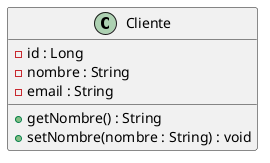

### 5.2. Visibilidad

| Símbolo | Visibilidad |
|---|---|
| `-` | privado |
| `#` | protegido |
| `~` | paquete |
| `+` | público |

Para mostrar los símbolos en texto en lugar de iconos:

```plantuml
skinparam classAttributeIconSize 0
```

### 5.3. Modificadores y tipos de clase

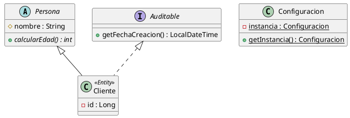

Palabras reservadas para declarar elementos:

| Palabra | Elemento |
|---|---|
| `class` | Clase |
| `abstract class` / `abstract` | Clase abstracta |
| `interface` | Interfaz |
| `enum` | Enumerado |
| `entity` | Entidad |
| `annotation` | Anotación |
| `struct` | Estructura |
| `record` | Registro (Java 16+) |
| `exception` | Excepción |
| `object` | Objeto (instancia) |

### 5.4. Clases genéricas

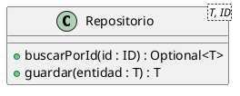

### 5.5. Ocultar miembros vacíos

```plantuml
hide empty members
hide empty methods
hide empty fields
```

---

## 6. Enumerados (enums)

Los enumerados son muy útiles en E/R para documentar columnas con un conjunto cerrado de valores (`ENUM` de MySQL, restricciones `CHECK` o tablas de dominio).

### 6.1. Enumerado simple

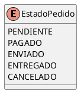

### 6.2. Enumerado con descripción o valores

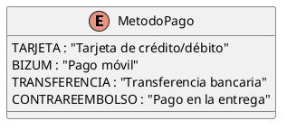

### 6.3. Enumerado vinculado a una entidad

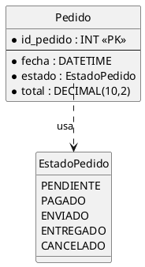

> La sintaxis `Entidad::campo` permite enlazar una relación a un atributo concreto en lugar de a la entidad completa. Es muy útil para señalar exactamente qué campo es la clave foránea.

### 6.4. Enumerado con métodos (estilo Java)

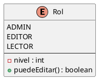

---

## 7. Relaciones y cardinalidad (notación pata de gallo)

Es la parte más importante de un diagrama E/R. PlantUML usa la notación de **Ingeniería de la Información** (*crow's foot* o pata de gallo).

### 7.1. Símbolos de cardinalidad

Cada extremo de la relación se compone de dos caracteres:

| Extremo izquierdo | Extremo derecho | Significado |
|---|---|---|
| `\|o` | `o\|` | Cero o uno (0..1) |
| `\|\|` | `\|\|` | Exactamente uno (1) |
| `}o` | `o{` | Cero o muchos (0..N) |
| `}\|` | `\|{` | Uno o muchos (1..N) |

Regla mnemotécnica:

- `|` = **uno** (una raya).
- `o` = **cero** (un círculo).
- `{` o `}` = **muchos** (la pata de gallo).
- El símbolo **más alejado** de la entidad es el **mínimo**; el **más cercano**, el **máximo**.

### 7.2. Sintaxis general

```
EntidadA <cardinalidadA>--<cardinalidadB> EntidadB : etiqueta
```

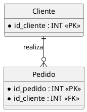

Se lee: *"Un cliente realiza cero o muchos pedidos; cada pedido pertenece exactamente a un cliente."*

### 7.3. Todas las combinaciones habituales

```plantuml
@startuml
hide circle

entity A1
entity B1
entity A2
entity B2
entity A3
entity B3
entity A4
entity B4
entity A5
entity B5

A1 ||--|| B1 : "1 : 1"
A2 ||--o| B2 : "1 : 0..1"
A3 ||--o{ B3 : "1 : 0..N"
A4 ||--|{ B4 : "1 : 1..N"
A5 }o--o{ B5 : "N : M"
@enduml
```

### 7.4. Línea continua frente a discontinua

- `--` línea **continua**: relación **identificadora** (la FK forma parte de la PK de la entidad hija).
- `..` línea **discontinua**: relación **no identificadora** (la FK es un atributo normal).

```plantuml
@startuml
hide circle

entity Factura {
  * id_factura : INT <<PK>>
}

entity LineaFactura {
  * id_factura : INT <<PK, FK>>
  * num_linea : INT <<PK>>
}

entity Cliente {
  * id_cliente : INT <<PK>>
}

Factura ||--|{ LineaFactura : "identificadora"
Cliente ||..o{ Factura : "no identificadora"
@enduml
```

### 7.5. Dirección y longitud de las líneas

Se puede sugerir hacia dónde va la relación y alargar la línea con más guiones:

```plantuml
@startuml
hide circle

entity Centro
entity Arriba
entity Abajo
entity Izquierda
entity Derecha

Centro ||-up-o{ Arriba
Centro ||-down-o{ Abajo
Centro ||-left-o{ Izquierda
Centro ||-right-o{ Derecha
@enduml
```

| Modificador | Abreviatura |
|---|---|
| `-up-` | `-u-` |
| `-down-` | `-d-` |
| `-left-` | `-l-` |
| `-right-` | `-r-` |

Más guiones equivalen a una línea más larga: `||---o{` o `||----o{`.

### 7.6. Etiquetas con dirección de lectura

Los caracteres `>` y `<` al final de la etiqueta indican el sentido de lectura:

```plantuml
@startuml
hide circle
entity Autor
entity Libro

Autor }|--|{ Libro : escribe >
@enduml
```

---

## 8. Relaciones de diagrama de clases

Cuando se modela con `class`, se usan las relaciones UML clásicas.

| Código | Tipo | Significado |
|---|---|---|
| `A -- B` | Asociación | Relación genérica |
| `A --> B` | Asociación dirigida | A conoce a B |
| `A <\|-- B` | Herencia (generalización) | B es un A |
| `A <\|.. B` | Realización | B implementa la interfaz A |
| `A *-- B` | Composición | B no existe sin A (ciclo de vida compartido) |
| `A o-- B` | Agregación | A contiene B, pero B puede existir por sí mismo |
| `A ..> B` | Dependencia | A usa B de forma puntual |
| `A ..` B | Línea punteada | Enlace débil o nota |

### 8.1. Multiplicidad

Se indica entre comillas en cada extremo:

```plantuml
@startuml
class Cliente
class Pedido
class LineaPedido
class Producto
class Direccion

Cliente "1" -- "0..*" Pedido : realiza >
Pedido "1" *-- "1..*" LineaPedido : contiene
LineaPedido "*" --> "1" Producto : referencia
Cliente "1" o-- "0..*" Direccion : tiene
@enduml
```

Valores de multiplicidad habituales: `1`, `0..1`, `0..*`, `*`, `1..*`, `n`, `2..5`.

### 8.2. Ejemplo combinado

```plantuml
@startuml
skinparam classAttributeIconSize 0

abstract class Vehiculo {
  # matricula : String
  # marca : String
}

class Coche {
  - numPuertas : int
}

class Moto {
  - cilindrada : int
}

class Motor {
  - potencia : int
}

class Garaje

interface Asegurable {
  + calcularPrima() : double
}

Vehiculo <|-- Coche
Vehiculo <|-- Moto
Asegurable <|.. Vehiculo
Vehiculo "1" *-- "1" Motor
Garaje "1" o-- "0..*" Vehiculo
@enduml
```

---

## 9. Casos típicos de modelado

### 9.1. Relación 1:1

Un usuario tiene, como mucho, un perfil; cada perfil pertenece a un único usuario.

```plantuml
@startuml
hide circle
skinparam linetype ortho

entity Usuario {
  * id_usuario : INT <<PK>>
  --
  * email : VARCHAR(150) <<UK>>
}

entity Perfil {
  * id_usuario : INT <<PK, FK>>
  --
  biografia : TEXT
  avatar_url : VARCHAR(255)
}

Usuario ||--o| Perfil
@enduml
```

### 9.2. Relación 1:N

```plantuml
@startuml
hide circle
skinparam linetype ortho

entity Departamento {
  * id_departamento : INT <<PK>>
  --
  * nombre : VARCHAR(80)
}

entity Empleado {
  * id_empleado : INT <<PK>>
  --
  * nombre : VARCHAR(80)
  * id_departamento : INT <<FK>>
}

Departamento ||--o{ Empleado : emplea
@enduml
```

### 9.3. Relación N:M con tabla intermedia

En el modelo relacional, una relación N:M se resuelve con una tabla intermedia (también llamada tabla puente, de unión o asociativa):

```plantuml
@startuml
hide circle
skinparam linetype ortho

entity Alumno {
  * id_alumno : INT <<PK>>
  --
  * nombre : VARCHAR(100)
}

entity Asignatura {
  * id_asignatura : INT <<PK>>
  --
  * nombre : VARCHAR(100)
  * creditos : TINYINT
}

entity Matricula {
  * id_alumno : INT <<PK, FK>>
  * id_asignatura : INT <<PK, FK>>
  --
  * curso_academico : CHAR(9)
  nota : DECIMAL(4,2)
}

Alumno ||--o{ Matricula
Asignatura ||--o{ Matricula
@enduml
```

### 9.4. Relación reflexiva (autorreferencia)

Un empleado puede tener un jefe, que a su vez es otro empleado:

```plantuml
@startuml
hide circle

entity Empleado {
  * id_empleado : INT <<PK>>
  --
  * nombre : VARCHAR(80)
  id_jefe : INT <<FK>>
}

Empleado |o--o{ Empleado : "es jefe de"
@enduml
```

### 9.5. Jerarquía (especialización / generalización)

Las jerarquías no existen como tal en el modelo relacional, pero se pueden documentar así:

```plantuml
@startuml
hide circle
skinparam linetype ortho

entity Persona {
  * id_persona : INT <<PK>>
  --
  * nombre : VARCHAR(100)
  * dni : CHAR(9) <<UK>>
}

entity Profesor {
  * id_persona : INT <<PK, FK>>
  --
  * especialidad : VARCHAR(80)
}

entity Estudiante {
  * id_persona : INT <<PK, FK>>
  --
  * num_expediente : VARCHAR(20)
}

Persona ||--o| Profesor
Persona ||--o| Estudiante

note bottom of Persona
  Jerarquía total y solapada:
  una persona puede ser
  profesor y estudiante a la vez.
end note
@enduml
```

Estrategias para trasladar una jerarquía a tablas:

| Estrategia | Descripción | Ventaja | Inconveniente |
|---|---|---|---|
| Una tabla por jerarquía | Todo en una tabla con columna discriminadora | Consultas rápidas | Muchos campos nulos |
| Una tabla por subtipo | Solo tablas hijas con todos los campos | Sin nulos | Duplicación de columnas |
| Una tabla por entidad | Padre e hijas enlazadas por PK/FK (el ejemplo) | Modelo normalizado | Requiere `JOIN` |

### 9.6. Relación ternaria

```plantuml
@startuml
hide circle
skinparam linetype ortho

entity Medico {
  * id_medico : INT <<PK>>
}

entity Paciente {
  * id_paciente : INT <<PK>>
}

entity Sala {
  * id_sala : INT <<PK>>
}

entity Cita {
  * id_cita : INT <<PK>>
  --
  * id_medico : INT <<FK>>
  * id_paciente : INT <<FK>>
  * id_sala : INT <<FK>>
  * fecha_hora : DATETIME
}

Medico ||--o{ Cita
Paciente ||--o{ Cita
Sala ||--o{ Cita
@enduml
```

### 9.7. Tabla de dominio en lugar de enum

A menudo es preferible una tabla de catálogo frente a un `ENUM`, ya que permite añadir valores sin alterar el esquema:

```plantuml
@startuml
hide circle

entity Provincia {
  * id_provincia : TINYINT <<PK>>
  --
  * nombre : VARCHAR(50)
  * codigo_ine : CHAR(2) <<UK>>
}

entity Direccion {
  * id_direccion : INT <<PK>>
  --
  * calle : VARCHAR(150)
  * codigo_postal : CHAR(5)
  * id_provincia : TINYINT <<FK>>
}

Provincia ||--o{ Direccion
@enduml
```

---

## 10. Notación de Chen

Las versiones recientes de PlantUML soportan la **notación de Chen** clásica, la que se enseña habitualmente en las asignaturas de bases de datos: rectángulos para entidades, rombos para relaciones y elipses para atributos.

Se usa el bloque `@startchen` / `@endchen`.

### 10.1. Elementos básicos

```plantuml
@startchen

entity ALUMNO {
  DNI <<key>>
  Nombre {
    NombrePila
    Apellidos
  }
  FechaNacimiento
  Edad <<derived>>
  Telefono <<multi>>
}

entity ASIGNATURA {
  Codigo <<key>>
  Titulo
  Creditos
}

relationship CURSA {
  Nota
}

ALUMNO -N- CURSA
CURSA -M- ASIGNATURA

@endchen
```

Estereotipos de atributos en notación de Chen:

| Estereotipo | Significado | Representación |
|---|---|---|
| `<<key>>` | Atributo clave | Subrayado |
| `<<derived>>` | Atributo derivado (calculado) | Elipse discontinua |
| `<<multi>>` | Atributo multivaluado | Elipse doble |
| `Atributo { ... }` | Atributo compuesto | Elipses anidadas |

### 10.2. Entidades débiles y participación total

```plantuml
@startchen

entity EMPLEADO {
  NumEmpleado <<key>>
  Nombre
}

entity FAMILIAR <<weak>> {
  Nombre <<key>>
  Parentesco
}

relationship TIENE_A_CARGO <<identifying>> {
}

EMPLEADO -1- TIENE_A_CARGO
TIENE_A_CARGO =N= FAMILIAR

@endchen
```

- `<<weak>>` en una entidad: **entidad débil** (rectángulo doble).
- `<<identifying>>` en una relación: **relación identificadora** (rombo doble).
- `=N=` (signo igual): **participación total** (línea doble).
- `-N-` (guion): participación parcial.

### 10.3. Restricciones estructurales (mín, máx)

```plantuml
@startchen

entity PROFESOR {
  Id <<key>>
}

entity DEPARTAMENTO {
  Codigo <<key>>
}

relationship PERTENECE {
}

PROFESOR -(1,1)- PERTENECE
PERTENECE -(0,N)- DEPARTAMENTO

@endchen
```

> Si la notación de Chen no funciona en tu instalación, actualiza PlantUML: es una funcionalidad relativamente reciente.

---

## 11. Organización: paquetes, notas y dirección

### 11.1. Paquetes y agrupaciones

Para modelos grandes conviene agrupar las entidades por áreas funcionales o esquemas:

```plantuml
@startuml
hide circle
skinparam linetype ortho

package "Ventas" #EEF5FF {
  entity Pedido {
    * id_pedido : INT <<PK>>
  }
  entity LineaPedido {
    * id_linea : INT <<PK>>
  }
}

package "Catálogo" #F0FFF0 {
  entity Producto {
    * id_producto : INT <<PK>>
  }
  entity Categoria {
    * id_categoria : INT <<PK>>
  }
}

Pedido ||--|{ LineaPedido
LineaPedido }o--|| Producto
Categoria ||--o{ Producto
@enduml
```

Estilos de agrupación disponibles:

```plantuml
package "Paquete" <<Folder>> { }
package "Rectángulo" <<Rectangle>> { }
package "Base de datos" <<Database>> { }
package "Nube" <<Cloud>> { }
package "Marco" <<Frame>> { }
namespace esquema.ventas { }
together { }
```

> `together { ... }` agrupa elementos visualmente sin dibujar ningún marco. Útil para obligar al motor a colocarlos juntos.

### 11.2. Notas

```plantuml
@startuml
hide circle

entity Pedido {
  * id_pedido : INT <<PK>>
  * total : DECIMAL(10,2)
}

note right of Pedido
  El **total** se recalcula
  mediante un //trigger//
  al modificar las líneas.
end note

note "Nota flotante" as N1
N1 .. Pedido

note top of Pedido : Nota de una línea
@enduml
```

Las notas también se pueden asociar a relaciones:

```plantuml
@startuml
hide circle
entity Cliente
entity Pedido

Cliente ||--o{ Pedido
note on link
  Borrado en cascada
  desactivado
end note
@enduml
```

### 11.3. Dirección del diagrama

```plantuml
' Por defecto, de arriba abajo
top to bottom direction

' De izquierda a derecha (muy útil para modelos anchos)
left to right direction
```

### 11.4. Elementos ocultos para forzar la disposición

Cuando el diseño automático no coloca los elementos donde se desea, se pueden usar enlaces invisibles:

```plantuml
@startuml
hide circle
entity A
entity B
entity C

A -[hidden]right- B
B -[hidden]right- C
@enduml
```

---

## 12. Estilos y apariencia

### 12.1. Ajustes recomendados para E/R

```plantuml
@startuml
' Quita el círculo con la "E"
hide circle

' Líneas en ángulo recto (más legible en E/R)
skinparam linetype ortho

' Alternativa: líneas poligonales
' skinparam linetype polyline

' Sombra y aspecto
skinparam shadowing false
skinparam roundCorner 8

' Tipografía
skinparam defaultFontName "Segoe UI"
skinparam defaultFontSize 12

' Colores de las entidades
skinparam class {
  BackgroundColor #FDFDFD
  BorderColor #4A6FA5
  ArrowColor #4A6FA5
  HeaderBackgroundColor #DCE6F5
}

' Separación entre elementos
skinparam nodesep 60
skinparam ranksep 60
@enduml
```

> Nota: aunque se use `entity`, internamente PlantUML lo trata como un elemento del diagrama de clases, por eso los parámetros se configuran con `skinparam class`.

### 12.2. Temas

PlantUML incluye temas predefinidos:

```plantuml
@startuml
!theme plain
hide circle

entity Cliente {
  * id : INT
}
@enduml
```

Algunos temas útiles: `plain`, `vibrant`, `cerulean`, `materia`, `sketchy-outline`, `aws-orange`, `mars`, `toy`.

Para ver todos los disponibles:

```plantuml
@startuml
help themes
@enduml
```

### 12.3. Color por entidad

```plantuml
@startuml
hide circle

entity Cliente #E8F4FD
entity Pedido #FFF4E0
entity "Tabla auditoría" as audit #EEEEEE;line.dashed

Cliente ||--o{ Pedido
@enduml
```

### 12.4. Colores en las relaciones

```plantuml
@startuml
hide circle
entity A
entity B
entity C

A ||-[#red]-o{ B
A ||-[#0055AA,dashed]-o{ C
A ||-[bold]-|| B
@enduml
```

### 12.5. Estilos CSS (sintaxis moderna)

Las versiones recientes admiten una sintaxis tipo CSS mediante `<style>`:

```plantuml
@startuml
<style>
classDiagram {
  class {
    BackgroundColor #FAFAFA
    LineColor #2E5984
    RoundCorner 10
  }
  arrow {
    LineColor #2E5984
  }
}
</style>

hide circle
entity Cliente
entity Pedido
Cliente ||--o{ Pedido
@enduml
```

---

## 13. Macros y preprocesador

El preprocesador de PlantUML permite reutilizar código y crear convenciones propias. Es muy práctico en modelos grandes.

### 13.1. Funciones para marcar claves

```plantuml
@startuml
hide circle
skinparam linetype ortho

!function $pk($nombre)
!return "<color:#B8860B><&key></color> <b>" + $nombre + "</b>"
!endfunction

!function $fk($nombre)
!return "<color:#7A7A7A><&link-intact></color> <i>" + $nombre + "</i>"
!endfunction

!function $uk($nombre)
!return "<color:#2E8B57><&star></color> " + $nombre
!endfunction

entity Cliente {
  $pk("id_cliente") : INT
  --
  $uk("email") : VARCHAR(150)
  nombre : VARCHAR(100)
}

entity Pedido {
  $pk("id_pedido") : INT
  --
  $fk("id_cliente") : INT
  fecha : DATE
}

Cliente ||--o{ Pedido
@enduml
```

### 13.2. Procedimientos para generar bloques repetidos

```plantuml
@startuml
hide circle

!procedure $auditoria()
  -- Auditoría --
  creado_en : TIMESTAMP
  creado_por : VARCHAR(50)
  modificado_en : TIMESTAMP
  modificado_por : VARCHAR(50)
!endprocedure

!procedure $tabla($nombre, $alias)
entity "$nombre" as $alias << (T,#ADD1B2) >>
!endprocedure

$tabla("Cliente", cli) {
  * id_cliente : INT
  nombre : VARCHAR(100)
  $auditoria()
}
@enduml
```

### 13.3. Variables, condicionales e inclusión de ficheros

```plantuml
@startuml
!$MOSTRAR_AUDITORIA = %true()

hide circle

entity Producto {
  * id_producto : INT
  nombre : VARCHAR(100)
!if ($MOSTRAR_AUDITORIA)
  -- Auditoría --
  creado_en : TIMESTAMP
!endif
}
@enduml
```

Para compartir estilos y macros entre diagramas:

```plantuml
@startuml
!include estilos/comun.iuml
!include macros/claves.iuml

entity Cliente
@enduml
```

> Por convención, los ficheros que solo contienen definiciones a incluir usan la extensión `.iuml`.

---

## 14. Ejemplo completo: tienda online

Modelo que reúne todo lo anterior: entidades, enumerados, todas las cardinalidades, paquetes, notas, macros y estilos.

```plantuml
@startuml tienda_online
!pragma layout smetana
!theme plain

hide circle
hide empty members
skinparam linetype ortho
skinparam shadowing false
skinparam roundCorner 6
skinparam nodesep 50
skinparam ranksep 60

!function $pk($n)
!return "<color:#B8860B><&key></color> <b>" + $n + "</b>"
!endfunction

!function $fk($n)
!return "<color:#808080><&link-intact></color> " + $n
!endfunction

title Modelo de datos — Tienda online

package "Clientes" #EEF5FF {

  entity Cliente {
    $pk("id_cliente") : INT
    --
    * nombre : VARCHAR(100)
    * apellidos : VARCHAR(150)
    * email : VARCHAR(150) <<UK>>
    telefono : VARCHAR(20)
    * fecha_alta : DATE
  }

  entity Direccion {
    $pk("id_direccion") : INT
    --
    $fk("id_cliente") : INT
    * calle : VARCHAR(150)
    * ciudad : VARCHAR(80)
    * codigo_postal : CHAR(5)
    * provincia : VARCHAR(50)
    * predeterminada : BOOLEAN
  }
}

package "Catálogo" #F0FFF0 {

  entity Categoria {
    $pk("id_categoria") : INT
    --
    * nombre : VARCHAR(80)
    $fk("id_categoria_padre") : INT
  }

  entity Producto {
    $pk("id_producto") : INT
    --
    $fk("id_categoria") : INT
    * sku : VARCHAR(30) <<UK>>
    * nombre : VARCHAR(150)
    descripcion : TEXT
    * precio : DECIMAL(10,2)
    * iva : TipoIVA
    * stock : INT
  }

  enum TipoIVA {
    GENERAL : 21 %
    REDUCIDO : 10 %
    SUPERREDUCIDO : 4 %
    EXENTO : 0 %
  }
}

package "Ventas" #FFF7E6 {

  entity Pedido {
    $pk("id_pedido") : INT
    --
    $fk("id_cliente") : INT
    $fk("id_direccion_envio") : INT
    * fecha : DATETIME
    * estado : EstadoPedido
    * total : DECIMAL(10,2)
  }

  entity LineaPedido {
    $pk("id_pedido") : INT
    $pk("num_linea") : SMALLINT
    --
    $fk("id_producto") : INT
    * cantidad : INT
    * precio_unitario : DECIMAL(10,2)
  }

  entity Pago {
    $pk("id_pago") : INT
    --
    $fk("id_pedido") : INT
    * metodo : MetodoPago
    * importe : DECIMAL(10,2)
    * fecha : DATETIME
    referencia_externa : VARCHAR(100)
  }

  enum EstadoPedido {
    PENDIENTE
    PAGADO
    ENVIADO
    ENTREGADO
    CANCELADO
  }

  enum MetodoPago {
    TARJETA
    BIZUM
    TRANSFERENCIA
    CONTRAREEMBOLSO
  }
}

' --- Relaciones ---
Cliente ||..o{ Direccion : tiene
Cliente ||..o{ Pedido : realiza
Direccion ||..o{ Pedido : "se envía a"

Categoria ||..o{ Producto : agrupa
Categoria |o..o{ Categoria : "subcategoría de"

Pedido ||--|{ LineaPedido : contiene
Producto ||..o{ LineaPedido : "aparece en"
Pedido ||..o| Pago : "se abona con"

' --- Enumerados ---
Pedido::estado ..> EstadoPedido
Pago::metodo ..> MetodoPago
Producto::iva ..> TipoIVA

note right of LineaPedido
  **precio_unitario** se copia del
  producto en el momento de la compra
  para conservar el histórico.
end note

legend right
  <color:#B8860B><&key></color> Clave primaria
  <color:#808080><&link-intact></color> Clave foránea
  Línea continua: relación identificadora
  Línea discontinua: relación no identificadora
endlegend

@enduml
```

### SQL equivalente (fragmento)

Para comprobar la correspondencia entre diagrama y esquema físico:

```sql
CREATE TABLE cliente (
  id_cliente   INT          PRIMARY KEY AUTO_INCREMENT,
  nombre       VARCHAR(100) NOT NULL,
  apellidos    VARCHAR(150) NOT NULL,
  email        VARCHAR(150) NOT NULL UNIQUE,
  telefono     VARCHAR(20),
  fecha_alta   DATE         NOT NULL
);

CREATE TABLE pedido (
  id_pedido          INT           PRIMARY KEY AUTO_INCREMENT,
  id_cliente         INT           NOT NULL,
  id_direccion_envio INT           NOT NULL,
  fecha              DATETIME      NOT NULL,
  estado             ENUM('PENDIENTE','PAGADO','ENVIADO','ENTREGADO','CANCELADO') NOT NULL,
  total              DECIMAL(10,2) NOT NULL,
  FOREIGN KEY (id_cliente)         REFERENCES cliente(id_cliente),
  FOREIGN KEY (id_direccion_envio) REFERENCES direccion(id_direccion)
);

CREATE TABLE linea_pedido (
  id_pedido       INT           NOT NULL,
  num_linea       SMALLINT      NOT NULL,
  id_producto     INT           NOT NULL,
  cantidad        INT           NOT NULL CHECK (cantidad > 0),
  precio_unitario DECIMAL(10,2) NOT NULL,
  PRIMARY KEY (id_pedido, num_linea),
  FOREIGN KEY (id_pedido)   REFERENCES pedido(id_pedido) ON DELETE CASCADE,
  FOREIGN KEY (id_producto) REFERENCES producto(id_producto)
);
```

Correspondencia entre diagrama y SQL:

| En el diagrama | En SQL |
|---|---|
| `*` delante del campo | `NOT NULL` |
| `<<PK>>` / icono de llave | `PRIMARY KEY` |
| `<<FK>>` | `FOREIGN KEY ... REFERENCES` |
| `<<UK>>` | `UNIQUE` |
| `\|\|--\|{` (identificadora) | FK incluida en la PK compuesta |
| `\|\|..o{` (no identificadora) | FK como columna normal |
| `\|o..` (cero o uno) | FK que admite `NULL` |
| `enum` | `ENUM(...)`, `CHECK (... IN (...))` o tabla de dominio |

---

## 15. Buenas prácticas

1. **Un fichero por diagrama** con extensión `.puml`, guardado junto al código o en una carpeta `docs/`.
2. **Separa estilos y macros** en ficheros `.iuml` comunes e inclúyelos con `!include`. Así todos los diagramas del proyecto tienen el mismo aspecto.
3. **Usa siempre `hide circle` y `skinparam linetype ortho`** en diagramas E/R: quedan más limpios y legibles.
4. **Clave primaria arriba**, separada con `--` del resto de atributos.
5. **Nomenclatura coherente**: elige `snake_case` o `camelCase`, singular o plural, y respétalo en todo el modelo.
6. **Alias cortos** con `as` para nombres largos o con caracteres especiales.
7. **Divide los modelos grandes** en varios diagramas por área funcional (ventas, catálogo, usuarios) y uno general solo con nombres de entidades.
8. **Muestra solo lo relevante**: para un diagrama de alto nivel, oculta los atributos con `hide members`.
9. **Etiqueta las relaciones** con un verbo (`realiza`, `contiene`, `pertenece a`) para que el diagrama se lea como frases.
10. **Exporta a SVG** para documentación: pesa poco, escala perfectamente y el texto es seleccionable.
11. **Automatiza la generación** en tu integración continua (por ejemplo, con la imagen Docker oficial) para que las imágenes estén siempre actualizadas.
12. **Mantén diagrama y esquema sincronizados**: si cambias una migración, actualiza el `.puml` en el mismo *commit*.

---

## 16. Errores frecuentes

| Problema | Causa probable | Solución |
|---|---|---|
| `Syntax Error?` en una línea | Falta `@enduml`, llave sin cerrar o carácter no válido | Revisa la línea indicada y la anterior |
| "Cannot find Graphviz" / "dot executable" | Graphviz no instalado o no está en el `PATH` | Instala Graphviz o añade `!pragma layout smetana` |
| La relación crea una entidad nueva vacía | Nombre mal escrito o alias distinto (distingue mayúsculas) | Usa exactamente el mismo identificador o alias |
| Nombres con espacios o tildes fallan | Falta usar comillas | `entity "Línea pedido" as linea` |
| `linetype ortho` no muestra las etiquetas bien | Limitación conocida del modo ortogonal | Prueba `skinparam linetype polyline` o acorta las etiquetas |
| Diagrama gigante e ilegible | Demasiadas entidades en un único diagrama | Divide en paquetes o en varios diagramas |
| `@startchen` no se reconoce | Versión de PlantUML antigua | Actualiza a una versión reciente |
| Caracteres extraños (tildes, ñ) | Codificación del fichero incorrecta | Guarda en UTF-8 o usa `-charset UTF-8` |
| Imagen recortada | Límite de tamaño por defecto (4096 px) | Ejecuta con `-DPLANTUML_LIMIT_SIZE=8192` o usa SVG |

---

## 17. Chuleta rápida

### Estructura

```plantuml
@startuml
hide circle
skinparam linetype ortho

entity "Nombre visible" as alias {
  * campo_pk : TIPO <<PK>>
  --
  * campo_obligatorio : TIPO
  campo_opcional : TIPO
  campo_fk : TIPO <<FK>>
}

enum NombreEnum {
  VALOR_1
  VALOR_2
}
@enduml
```

### Cardinalidades (pata de gallo)

| Código | Lectura |
|---|---|
| `A \|\|--\|\| B` | Uno a uno |
| `A \|\|--o\| B` | Uno a cero o uno |
| `A \|\|--o{ B` | Uno a cero o muchos |
| `A \|\|--\|{ B` | Uno a uno o muchos |
| `A }o--o{ B` | Muchos a muchos |
| `--` | Relación identificadora |
| `..` | Relación no identificadora |

### Relaciones de clases

| Código | Tipo |
|---|---|
| `<\|--` | Herencia |
| `<\|..` | Implementación |
| `*--` | Composición |
| `o--` | Agregación |
| `-->` | Asociación dirigida |
| `..>` | Dependencia |

### Notación de Chen

| Código | Significado |
|---|---|
| `entity X { }` | Entidad |
| `entity X <<weak>>` | Entidad débil |
| `relationship R { }` | Relación |
| `relationship R <<identifying>>` | Relación identificadora |
| `attr <<key>>` | Atributo clave |
| `attr <<derived>>` | Atributo derivado |
| `attr <<multi>>` | Atributo multivaluado |
| `-N-` / `=N=` | Participación parcial / total |
| `-(0,N)-` | Restricción (mín, máx) |

### Ajustes visuales más útiles

| Instrucción | Efecto |
|---|---|
| `hide circle` | Quita el icono de la entidad |
| `hide empty members` | Oculta compartimentos vacíos |
| `hide members` | Muestra solo los nombres |
| `skinparam linetype ortho` | Líneas en ángulo recto |
| `left to right direction` | Orientación horizontal |
| `!theme plain` | Aplica un tema |
| `!pragma layout smetana` | Motor interno, sin Graphviz |

---

## Recursos

- Documentación oficial: `https://plantuml.com`
- Diagramas de clases: `https://plantuml.com/class-diagram`
- Diagramas E/R (pata de gallo): `https://plantuml.com/ie-diagram`
- Notación de Chen: `https://plantuml.com/chen-diagram`
- Preprocesador: `https://plantuml.com/preprocessing`
- Guía de referencia en PDF: disponible en la web oficial
- Editor en línea: `https://www.plantuml.com/plantuml`
